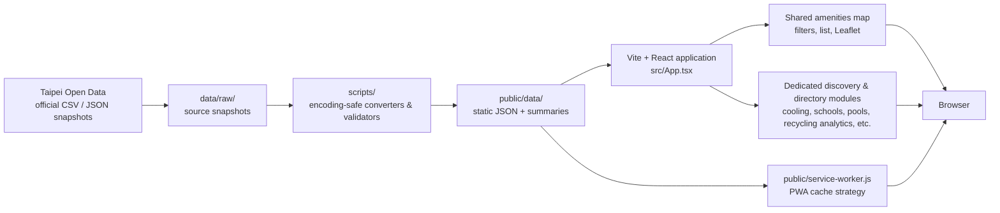
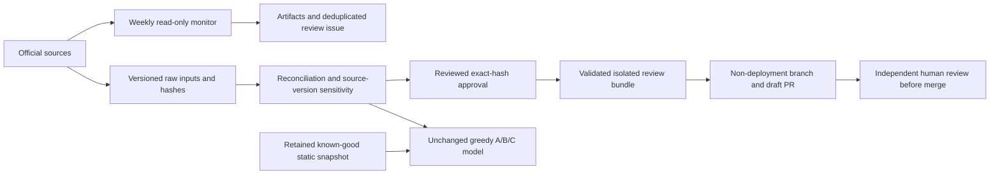

# Taipei Public Amenities Map

[English](README.md) | [繁體中文](README.zh-Hant.md)

A mobile-first, bilingual map and directory for public amenities in Taipei. It brings together official public datasets so residents and visitors can find facilities, compare source-recorded details, and check what still needs confirmation.

The app is static and PWA-ready. It requires no backend, account, database, Google Maps API key, or paid map service.

## What it supports

- Traditional Chinese by default, with an English interface toggle stored locally in the browser.
- Search, district filters, source-specific filters, address lookup links, and browser-permission-based nearby sorting.
- Leaflet maps with standard OpenStreetMap base tiles and a list-first policy for broad result sets.
- Local JSON datasets, a conversion-quality report, and offline-friendly service-worker caching.
- Accessible, responsive cards, directories, tables, CSV exports, keyboard controls, and mobile layouts.

## Architecture



The browser only reads generated local JSON at runtime. Data acquisition, decoding, validation, and normalization occur before deployment; the app does not call the Taipei Open Data API while a visitor is using it.

## Data modules

The main public-amenities map includes pedestrian bins, dog-waste bag boxes, public, riverside, and family-friendly toilets, drinking facilities, recycling services, lactation rooms, motorcycle inspection, electric-vehicle services, gas/LPG stations, smoking and no-smoking records, clean-needle service points, protected trees, parking, green-space adoption, and accessible public parking.

Dedicated directory or discovery routes provide additional source-specific experiences:

| Route | Module | Important boundary |
| --- | --- | --- |
| `#/bin-policy` | Public Bin Allocation Decision Support | Greedy straight-line screening of dated bus reference locations; candidates require field review and are not approved installation sites. |
| `#/cooling-comfort-spots` | Taipei Cooling & Comfort Spots | Source-listed amenities and hours are not real-time availability or emergency-shelter status. |
| `#/public-school-sports-venues` | Public School Sports Venue Search | Campus opening is not proof of booking, a specific sport, or a free time slot. |
| `#/bulky-waste-collection-booking` | Bulky Waste Collection Booking | Booking hours and phone information do not show real-time acceptance. |
| `#/unused-medicine-collection-stations` | Unused Medicine Collection Stations | Directory information is not medical advice or a current-acceptance guarantee. |
| `#/industrial-waste-reuse-operators` | Industrial Waste Reuse Operators | Registration records do not indicate public walk-in acceptance or current capacity. |
| `#/certified-bathhouses` | Certified Bathhouses | Certification records are not real-time opening, safety, or exact-location information. |
| `#/recycling-analytics` | Recycling Analytics | District recycling volume is not a recycling rate, efficiency, or environmental-performance score. |

## Data principles

### Bin policy v1.1: governance, not an automatic data migration

The policy route now includes distinct Data Health dates, conservative record-level bin reconciliation, and a newer official bus-source comparison. The audited 2021 references remain the default pending independent adoption review. Scheduled monitoring produces reports and deduplicated alerts only; a separate exact-hash, reviewed publication workflow stages a draft PR, never merges or pushes datasets into main.

The historical 1,197 map records, 681 current raw rows / 679 valid unique coordinates, 130 supplemental named-place rows, and the separate government claim of 806 groups / 1,612 bins use different definitions. Unmatched records are not presumed removals. Read the [bin reconciliation audit](docs/bin-policy-bin-reconciliation.zh-Hant.md) before comparing totals.



See [governance and publication instructions](docs/bin-policy-data-governance.zh-Hant.md), [bus migration evidence](docs/bin-policy-bus-stop-migration.md), and [v1.1 audit](docs/bin-policy-v1.1-audit.md). Production data and policy method remain unchanged by monitoring.

- The browser loads static local JSON; it never depends on the Taipei Open Data API at runtime.
- Raw source values are retained during conversion whenever possible. Derived classifications are labelled and source-specific.
- Exact map markers require validated official coordinates. Address-only or invalid-coordinate records remain usable in directories and are not automatically geocoded.
- Opening hours, equipment, phone numbers, access, capacity, prices, and availability are snapshots. Check the managing organization or on-site notice before relying on them.
- Browser location is used only after permission for the current client-side session; it is not persisted by the app.

## Install and run

```bash
npm install
npm run dev
```

Open the local URL displayed by Vite.

## Convert local data

Most source snapshots live under `data/raw/`; generated frontend data is written to `public/data/`.

```bash
# Rebuild the combined public-amenities map data
npm run convert:facilities

# Rebuild dedicated discovery and directory datasets
npm run data:convert:cooling-comfort-spots
npm run data:convert:public-school-sports-venues
npm run data:convert:bulky-waste-collection-booking
npm run data:convert:unused-medicine-collection-stations
npm run data:convert:industrial-waste-reuse-operators
npm run data:convert:certified-bathhouses
npm run data:convert:recycling-analytics
npm run data:convert:bin-policy -- data/raw/bin-policy/v1-14c24bcdbade
npm run data:reconcile:bins
npm run data:monitor:bin-policy -- test-results/bin-policy-monitor
npm run data:health:bin-policy -- test-results/bin-policy-monitor/report.json
npm run data:compare:bus-policy
```

Some datasets have separate fetch scripts that copy or retrieve an official source snapshot before conversion. See `package.json` for the complete command list. After conversion, inspect `public/data/conversion-report.json` and each module summary for source-specific quality results.

## Verify

```bash
npm test
npm run build
npm run test:e2e
npm run test:policy-preview # run npm run build first; tests cached-data offline fallback
./init.sh
```

Playwright starts its own Vite server. To avoid a locally occupied default port, choose another port:

```powershell
$env:PLAYWRIGHT_PORT='5175'; npm run test:e2e
```

## Deploy

The app can be deployed to Vercel, Netlify, or GitHub Pages as a static Vite site.

- Framework: `Vite`
- Install: `npm ci`
- Build: `npm run build`
- Output: `dist`
- Environment variables: none

See [deployment guide](docs/deployment.en.md).

## Documentation

- [Bin policy methodology, source audit and refresh process](docs/bin-policy-methodology.md)
- [Bin policy MVP guide (Traditional Chinese)](docs/bin-policy-mvp.zh-Hant.md)

- [Decision-making and operating advice (Traditional Chinese)](docs/dashboard-decision-making.zh-Hant.md)
- [System design](docs/system-design.en.md)
- [Architecture trade-offs](docs/tradeoffs.en.md)
- [Deployment guide](docs/deployment.en.md)

## License

See [LICENSE](LICENSE).
