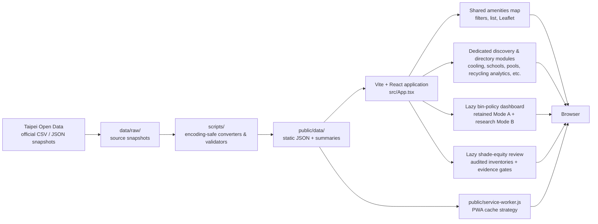

# Taipei Public Amenities Map

[English](README.md) | [繁體中文](README.zh-Hant.md)

A mobile-first, bilingual map and directory for public amenities in Taipei. It brings together official public datasets so residents and visitors can find facilities, compare source-recorded details, and check what still needs confirmation.

The app is static and PWA-ready. It requires no backend, account, database, Google Maps API key, or paid map service.

## What it supports

- Traditional Chinese by default, with an English interface toggle stored locally in the browser.
- Search, district filters, source-specific filters, address lookup links, and browser-permission-based nearby sorting.
- Leaflet maps with standard OpenStreetMap base tiles and a list-first policy for broad result sets.
- Local JSON datasets, a conversion-quality report, and offline-friendly service-worker caching.
- Accessible, responsive cards, directories, tables, CSV exports, keyboard controls, and mobile layouts.

## Architecture



The browser only reads generated local JSON at runtime. Data acquisition, decoding, validation, and normalization occur before deployment; the app does not call the Taipei Open Data API while a visitor is using it.

## Data modules

The main public-amenities map includes pedestrian bins, dog-waste bag boxes, public, riverside, and family-friendly toilets, drinking facilities, recycling services, lactation rooms, motorcycle inspection, electric-vehicle services, gas/LPG stations, smoking and no-smoking records, clean-needle service points, protected trees, parking, green-space adoption, and accessible public parking.

Dedicated directory or discovery routes provide additional source-specific experiences:

| Route | Module | Important boundary |
| --- | --- | --- |
| `#/bin-policy` | Public Bin Allocation Decision Support | Mode A retains equal transport coverage; Mode B studies category-balanced policy priorities with explicit weights, missing-data warnings and sensitivity. Neither approves installation sites. |
| `#/shade-equity` | Shade Equity & Urban Heat Preparedness | Registered trees are not canopy; pits are not vacant planting sites. Inventory and spatial review are available; ranking is blocked until measurement/comparability gates pass. |
| `#/cooling-comfort-spots` | Taipei Cooling & Comfort Spots | Source-listed amenities and hours are not real-time availability or emergency-shelter status. |
| `#/public-school-sports-venues` | Public School Sports Venue Search | Campus opening is not proof of booking, a specific sport, or a free time slot. |
| `#/swimming-pools` | Taipei Swimming Pool Finder | Official coordinates and contact details do not establish current opening, lifeguard staffing, or safe swimming conditions. |
| `#/bulky-waste-collection-booking` | Bulky Waste Collection Booking | Booking hours and phone information do not show real-time acceptance. |
| `#/unused-medicine-collection-stations` | Unused Medicine Collection Stations | Directory information is not medical advice or a current-acceptance guarantee. |
| `#/industrial-waste-reuse-operators` | Industrial Waste Reuse Operators | Registration records do not indicate public walk-in acceptance or current capacity. |
| `#/certified-bathhouses` | Certified Bathhouses | Certification records are not real-time opening, safety, or exact-location information. |
| `#/recycling-analytics` | Recycling Analytics | District recycling volume is not a recycling rate, efficiency, or environmental-performance score. |

## Data principles

### Shade Equity v1.0: inventory review with an explicit no-go gate

The independent `#/shade-equity` route audits roadside trees, official sidewalk polygons and tree-pit infrastructure, retaining separate source populations from protected trees, park context and Bin Policy. The 2026-10-20 source snapshot contains 90,358 tree rows, 15,053 sidewalk polygons and 56,720 pit/planter polygons; GIS admission retains 89,860 tree observations, 14,896 sidewalk units and 50,730 tree pits. These are source-backed observations, not complete physical inventories, shade coverage or vacant capacity.

The sidewalk length field's measurement definition/units and cross-source comparability are not adequately verified. Therefore actual eligible priority candidates are **zero**: capacity 5/10 and district balancing return no fabricated shortlist; low-recorded-tree density ranking is disabled. A/B/C tiers and non-empty scenarios are exercised with explicitly synthetic test fixtures only. Metadata loads first, with district details fetched on selection; raw files never go to the browser.

See the [source audit](docs/shade-equity-source-audit.md), [methodology](docs/shade-equity-methodology.md), [Traditional Chinese decision guide](docs/shade-equity-decision-mvp.zh-Hant.md) and [delivery evidence](docs/shade-equity-delivery.md). Source downloads do not grant analytical or municipal planting approval. No measured canopy, street-level heat or cooling-benefit model is claimed.

### Bin policy v1.2: separate policy-priority research mode

Select **Analysis mode → B. Policy priority allocation (research)** in the existing policy route. Mode A, its approved bins/2021 bus baseline and exports are unchanged. Mode B loads a separate review-required snapshot only after selection; default weights are tourism/vendor/market/commercial/MRT/bus = **4/4/3/3/2/1**, editable within 0–10 and resettable. Its score is `Σ(weight × newly covered category entities / fixed eligible category population)`, not a raw sum dominated by bus density, measured demand or policy effectiveness.

Actually integrated: 42 official vendor-concentration locations, 47 market references, 73 MRT station references and 3,395 retained bus references. Tourism acquisition was blocked by HTTP403; 235 commercial-directory rows lack defensible district geometry and remain context only. Missing categories are not zero demand and their weights are not redistributed. Candidate anchors are transport references, not approved sidewalk locations. The historical bin procedure stopped in 2022 is not applied as current law.

The dashboard compares equal category priorities, documented policy defaults, active edits and default-weight ±25% sensitivity using identical inputs. JSON and CSV retain method, weight and source versions separately. See the [methodology](docs/bin-policy-v1.2-methodology.md), [source audit](docs/bin-policy-v1.2-sources.md), [governance](docs/bin-policy-v1.2-governance.md), and [implementation evidence](docs/bin-policy-v1.2-audit.md).

Research monitoring distinguishes the exact previously audited/excluded Travel403 (`warning`, with visible Actions/Issue evidence) from new source failures (`failure`). This does not restore API access, admit tourism data, or suppress integrity checks; successful recovery still requires independent review.

### Bin policy v1.1: governance, not an automatic data migration

The policy route now includes distinct Data Health dates, conservative record-level bin reconciliation, and a newer official bus-source comparison. The audited 2021 references remain the default pending independent adoption review. Scheduled monitoring produces reports and deduplicated alerts only; a separate exact-hash, reviewed publication workflow stages a draft PR, never merges or pushes datasets into main.

The historical 1,197 map records, 681 current raw rows / 679 valid unique coordinates, 130 supplemental named-place rows, and the separate government claim of 806 groups / 1,612 bins use different definitions. Unmatched records are not presumed removals. Read the [bin reconciliation audit](docs/bin-policy-bin-reconciliation.zh-Hant.md) before comparing totals.


See [governance and publication instructions](docs/bin-policy-data-governance.zh-Hant.md), [bus migration evidence](docs/bin-policy-bus-stop-migration.md), and [v1.1 audit](docs/bin-policy-v1.1-audit.md). Production data and policy method remain unchanged by monitoring.

- The browser loads static local JSON; it never depends on the Taipei Open Data API at runtime.
- Raw source values are retained during conversion whenever possible. Derived classifications are labelled and source-specific.
- Exact map markers require validated official coordinates. Address-only or invalid-coordinate records remain usable in directories and are not automatically geocoded.
- Opening hours, equipment, phone numbers, access, capacity, prices, and availability are snapshots. Check the managing organization or on-site notice before relying on them.
- Browser location is used only after permission for the current client-side session; it is not persisted by the app.

## Install and run

Use Node.js `^20.19.0 || >=22.12.0` as declared in `package.json`; Node 22 is used by the source-monitor workflow. Use `npm ci` for a reproducible install from the lockfile.

```bash
npm install
npm run dev
```

Open the local URL displayed by Vite.

## Convert local data

Most source snapshots live under `data/raw/`; generated frontend data is written to `public/data/`.

```bash
# Rebuild the combined public-amenities map data
npm run convert:facilities

# Rebuild dedicated discovery and directory datasets
npm run data:convert:cooling-comfort-spots
npm run data:convert:public-school-sports-venues
npm run data:convert:bulky-waste-collection-booking
npm run data:convert:unused-medicine-collection-stations
npm run data:convert:industrial-waste-reuse-operators
npm run data:convert:certified-bathhouses
npm run data:convert:recycling-analytics
npm run data:convert:bin-policy -- data/raw/bin-policy/v1-14c24bcdbade
npm run data:reconcile:bins
npm run data:monitor:bin-policy -- test-results/bin-policy-monitor
npm run data:health:bin-policy -- test-results/bin-policy-monitor/report.json
npm run data:compare:bus-policy
npm run data:convert:policy-priority -- data/raw/bin-policy-priority/priority-v1-113edf6ed5e09ada data/raw/bin-policy/v1-14c24bcdbade/districts.zip
npm run benchmark:policy-priority

# Restore exact compressed shade-source evidence; do not substitute live bytes
npm run data:fetch:shade-equity -- --restore-frozen
npm run data:audit:shade-equity
npm run data:convert:shade-equity
```

Some datasets have separate fetch scripts that copy or retrieve an official source snapshot before conversion. See `package.json` for the complete command list. After conversion, inspect `public/data/conversion-report.json` and each module summary for source-specific quality results.

Conversion is a data-changing maintenance operation, not a deployment prerequisite. Do not refresh or adopt policy inputs without the documented review process. The research monitor may exit with failure when an upstream source is blocked; that does not authorize replacing the retained snapshot.

## Verify

```bash
npm test
npm run build
npm run test:e2e
npm run test:policy-preview # run npm run build first; tests cached-data offline fallback
npm run test:shade-preview # production-only shade inventory/offline behavior
./init.sh
```

`init.sh` is a Bash convenience wrapper for unit tests, build and E2E, not an additional independent check. In PowerShell, run the three npm commands directly.

Playwright starts its own Vite server. To avoid a locally occupied default port, choose another port:

```powershell
$env:PLAYWRIGHT_PORT='5175'; npm run test:e2e
```

## Deploy

The app can be deployed to Vercel, Netlify, or GitHub Pages as a static Vite site.

- Framework: `Vite`
- Install: `npm ci`
- Build: `npm run build`
- Output: `dist`
- Environment variables: none

See [deployment guide](docs/deployment.en.md).

## Documentation

- [Current handoff and verification status](session-handoff.md)
- [Policy v1.2 methodology](docs/bin-policy-v1.2-methodology.md), [sources](docs/bin-policy-v1.2-sources.md), and [governance](docs/bin-policy-v1.2-governance.md)
- [Bin policy methodology, source audit and refresh process](docs/bin-policy-methodology.md)
- [Bin policy MVP guide (Traditional Chinese)](docs/bin-policy-mvp.zh-Hant.md)

- [Decision-making and operating advice (Traditional Chinese)](docs/dashboard-decision-making.zh-Hant.md)
- [System design](docs/system-design.en.md)
- [Architecture trade-offs](docs/tradeoffs.en.md)
- [Deployment guide](docs/deployment.en.md)

## License

See [LICENSE](LICENSE).
