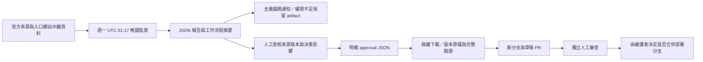

# 清潔箱政策分析 v1.1：資料治理與安全更新

本模組是靜態、可重現的資料快照分析，不是即時清潔箱營運系統。排程成功只代表某次檢查完成，不能證明來源資料最新、現場設施仍存在，或候選位置可以施工。

## 治理資料契約

既有 `analysis.json` 維持 `schemaVersion: 1`，不更改 greedy 模型、referenceCount、baselineCovered 或 incrementalCoverage 的意義。治理資訊另外放在 `data-health.json`，TypeScript 契約為 `src/lib/binPolicyGovernance.ts`。UI 必須先比對 `snapshotId`，不能把另一版快照的健康資訊套到目前分析。

| 欄位 | 意義 | 不可替代為 |
|---|---|---|
| source_updated_at | 官方資源記載的更新時間；缺少即 null | 本次下載時間 |
| retrieved_at | 成功取得目前發布內容的時間；監測明確記錄相同雜湊擷取成功時可前進，否則保留封存紀錄 | 原始來源發布時間或沒有擷取事件的監測時間 |
| validated_at | 本次實際通過本機分析契約驗證時間 | 檔案生成時間推算 |
| published_at | 已記錄的發布事件；目前沒有此事件紀錄，為 null | generatedAt 或 Git 提交時間 |
| last_checked_at | 同一已發布快照的實際監測執行時間 | 排程設定時間 |
| last_detected_change_at | 本次報告實際發現遠端內容雜湊不同的時間 | 猜測的來源修訂時間 |

`generatedAt` 僅是治理側檔生成時間。`sha256` 指明健康卡描述的已發布來源內容；偵測到新的遠端版本不會使舊版本自動變成該新版本。未知值顯示「未知／unknown」。最後偵測變更時間若無跨次歷史紀錄，會回復 unknown，不假裝永久記住變更歷史。

來源資料超過 365 天或日期未知會顯示 stale 警示。這是保守的治理門檻，不是認定資料錯誤。公車站 CRS 說明矛盾、排除資料及行政區邊界年代差異仍需另外閱讀。

## 排程監測與資料發布分離



`.github/workflows/bin-policy-source-monitor.yml` 每週與手動執行；12 分鐘上限、同群組序列化、讀取權限與通知權限分開。監測三個已核定分析來源，以及「景點商圈周邊」獨立對帳來源。尚未核定採用的新版公車候選來源，不假稱已成為正式分析資料。

`monitorBinPolicySources.ts` 在作業系統隨機暫存目錄下載，不修改 `analysis.json`、既有原檔或 Git。報告包含 HTTP 狀態、前後 SHA256、前後原始列數、來源識別、官方資源與入口網站中繼資料日期變更、結構／座標驗證、異常及人工處理事項。少於原始列數 80% 或超過 150% 的變化必須人工審查。區界仍要求 12 區；其餘沿用編碼、欄位、幾何及有效筆數檢查。

官方日期與 resource ID 取自 `data.taipei` 頁面內的 `__NUXT_DATA__` JSON 參照圖，僅解析 JSON，不執行網站 JavaScript。頁面結構改變、資源不見、下載失敗或日期缺漏會明確警告。HTTP Last-Modified 另列為傳輸層中繼資料，不視為發布日期。資料內容未變而中繼資料日期改變時，會得到 `change_detected`，但 `content_changed: false`。相同雜湊不產生新的來源發布日期。

排程將所有報告保留為 GitHub Actions artifact；目前保留 90 天，長期稽核請由維護者另外封存有意義版本。單一 bot 議題以隱藏識別標記定位，內容指紋不含執行時間；相同故障不重複發文。權限不足時只顯示明確限制並保留報告，不升權、不寫 main。沒有完整報告的安裝／執行環境故障請查工作流程失敗通知及執行紀錄。

## 受審查的發布流程

`.github/workflows/bin-policy-data-publish.yml` 只接受手動觸發，固定從 main 讀取已提交的 approval JSON；可選使用已版本化原檔，否則只下載核准的精確雜湊。環境名稱為 `bin-policy-data-review`；維護者應在 GitHub 設定 required reviewers 並保護 main。**YAML 宣告環境本身不會自動設定環境審核或分支保護**。

approval 必須包含明確審查者、日期、本 repository 的議題／PR 證據網址、舊／新快照 ID、每個來源的 resource ID、SHA256、官方更新日期，以及 metadata/schema/spatial/completeness/decision impact 五項審查聲明。這些聲明是可稽核的紀錄，程式無法驗證人是否真的做過審查；環境審核與獨立 PR review 仍是必要控制。

```json
{
  "schemaVersion": 1,
  "reviewed_by": "實際審查者；不可保留範例值",
  "reviewed_at": "實際 ISO 日期",
  "review_url": "https://github.com/LEO0331/taipei-bin-map/pull/實際編號",
  "metadata_reviewed": true,
  "schema_reviewed": true,
  "spatial_reviewed": true,
  "completeness_reviewed": true,
  "decision_impact_reviewed": true,
  "previous_snapshot_id": "實際已發布版本",
  "approved_snapshot_id": "實際候選版本",
  "sources": [{"source_id": "bins", "resource_id": "實際 ID", "sha256": "實際 64 位元十六進位 SHA256", "source_updated_at": "官方時間或 null"}]
}
```

上例刻意不是可執行的核准：sources 必須完整列出三個來源；時間、網址與雜湊必須有效。請先用隔離目錄取得候選來源並人工檢查，再提交真實 approval；不可為了讓排程變綠而杜撰審查。

發布準備程式依序驗證核准紀錄、resource ID、精確雜湊、schema、座標、完整性及列數變化，產生隔離審查 bundle。相同模型與相同參數產生來源變更和中正區 300m／5 座／不限預算的決策敏感度報告；這只是基本驗證情境，不能代替所有相關行政區與參數的影響審查，也不是政策實施效果。重大列數異常即使核准布林值為 true 仍阻擋，需另外審查 importer／門檻變更。

通過後，工作流程只在 `codex/bin-policy-data-<run>-<attempt>` 分支放入原始快照、分析、對帳、健康與決策影響報告；執行單元測試、建置及桌面／手機瀏覽器測試，再建立草稿 PR。沒有 auto-merge，沒有 main push。GitHub 若禁止 Actions 建 PR，分支與 artifacts 仍可由維護者手動審查；不假稱 PR 已建立。工作流程建立 PR 的 token 所觸發事件可能不會再次觸發 CI，因此發布流程本身先完成測試，維護者仍應依分支保護確認必要檢查。

同一內容雜湊版本的原始目錄若已存在，發布階段會核對其資源 ID、來源日期、編碼與 CRS 等中繼資料；衝突會阻擋，不能只比較內容雜湊後丟棄新的核准來源日期。相同內容重新下載時，重建使用既有封存清單，保留原擷取沿革；中繼資料單獨修訂須另做版本化沿革遷移。本階段會重建新快照對應的清潔箱對帳、公車比較／敏感度與健康側檔，避免新舊報告錯配；正式 JSON 替換採暫存檔後原子 rename。

任一前置驗證失敗都不寫入 production；暫存目錄唯一化，發布執行序列化，既有 review 輸出目錄拒絕覆蓋。`ready.json` 只在 bundle 全部寫入後出現。輸出若不完整只能當故障證據，不可發佈。原 `--accept-source-revision` 不能再單獨授權更新。

## 本機操作與可重現性

```powershell
# 唯讀網路檢查；僅寫 reports，失敗保留既有快照
npx tsx scripts/monitorBinPolicySources.ts reports/bin-policy/manual-check

# 驗證目前快照並產生健康側檔；可選擇引用同版本的監測報告
npx tsx scripts/buildBinPolicyHealth.ts reports/bin-policy/manual-check/report.json

# 從既有版本原檔重建同一版本；新來源修訂不允許經由此捷徑覆寫 production
npm run data:convert:bin-policy -- data/raw/bin-policy/v1-14c24bcdbade

# 新來源只能輸出獨立待審查檔案
npx tsx scripts/convertBinPolicySources.ts <版本原檔目錄> --output test-results/candidate-analysis.json

# 真實核准後準備 review bundle；不發佈、不推送
npx tsx scripts/prepareBinPolicyPublication.ts <已審查approval.json> test-results/new-review <核准原檔目錄>

# 保留原 npm entry，但必須傳入審查紀錄與新輸出目錄
npm run data:fetch:bin-policy -- --approval <已審查approval.json> --output test-results/new-review
```

監測本機實際執行結果留於 `reports/bin-policy/monitor-2026-10-15/`。是否曾在 GitHub 成功排程、建立 Issue、通過環境審核及建立發布 PR，須以該 repository 的實際 Actions 紀錄為準；本機測試不能證明這些權限已配置。

## 維護者設定清單

- 保護 main，禁止資料更新機器人直接推送，要求獨立 PR review。
- 設定 `bin-policy-data-review` required reviewers；限制可使用該環境的來源分支。
- 如允許自動草稿 PR，啟用 Actions 建立 PR 權限；否則人工由 review 分支開 PR。
- 檢查 Issue write 是否開放；未開放時以 artifact 和 workflow failure 通知補足。
- 確認週期排程在預設分支生效且 repository 活躍，定期檢查長期未執行的排程。
- 保留舊版原檔與對帳報告；不要把 historical_only 改稱 removed，也不要把資料版本敏感度變化改稱政策改善。
