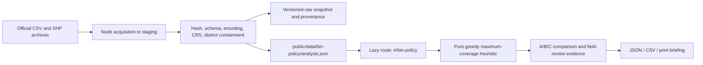

# Public bin allocation decision support MVP

This is a public-data screening prototype for policy analysts responding to [Policy Issue #2](https://puma.taipei/hackathon#issues). It identifies public bus reference locations that lack a nearby **listed** pedestrian bin and produces a reproducible field-review shortlist. It does not determine lawful installation suitability, walking access, demand, equity, operational status, or bin fullness.

## Implementation plan and architecture

One tracked feature, `feat-041`, on `codex/bin-policy-mvp`:

1. Audit the existing static app and source snapshots; establish tests/build baseline.
2. Acquire official bin CSV, bus SHP/DBF and district polygons; validate and publish a versioned analysis snapshot separately from ordinary facility data.
3. Add a pure deterministic coverage engine, scenario assumptions and evidence exports.
4. Add an independent lazy hash route, map, controls, candidate evidence, briefing and bilingual labels; verify all existing flows and document remaining gaps.



No new package dependencies. The dedicated Leaflet map leaves the shared facility map independent. The GIS snapshot loads only when the policy dashboard mounts. The service worker fetches policy data network-first after first use, with a cached fallback on network failure; it is not precached during ordinary facility visits. Input dates remain visible when a cached snapshot is used. Original facility snapshots are preserved.

## Sources actually integrated

Audit date: **2026-10-15 (Asia/Taipei)**. Retrieval timestamps and SHA256 hashes are recorded per source in `data/raw/bin-policy/v1-14c24bcdbade/sources.json` and the published snapshot. The metadata dates below were independently checked on the official dataset pages; retrieval time is never substituted for a resource update date.

| Source and provider | Resource identity | Resource / metadata date | Encoding and geometry |
| --- | --- | --- | --- |
| [Pedestrian bins](https://data.taipei/dataset/detail?id=a835f3ba-7f50-4b0d-91a6-9df128632d1c), Taipei Environmental Protection Department | `267d550f-c6ec-46e0-b8af-fd5a464eb098` | 2026-09-30 15:55:35 / 15:55:47 +08:00 | CP950 CSV, source geographic longitude/latitude |
| [Bus stops](https://data.taipei/dataset/detail?id=48aa5bca-2a4f-4fb7-a658-43cba51d5d56), Public Transportation Office | `dfd68d8e-d3b9-44df-b614-8850c103239f` | 2021-04-11 19:47:33 / 2022-08-29 08:33:20 +08:00 | Point SHP, UTF-8 DBF per `.cpg`; missing `.prj` |
| [District boundaries](https://data.taipei/dataset/detail?id=1601ef3a-c253-4988-b047-943d9e786143), Department of Civil Affairs | `d8b7eb29-136f-49fc-b14b-3489d3656122` | 2024-09-16 15:17:18 / 2025-12-24 08:19:00 +08:00 | Polygon SHP with TWD97/TM2 121° `.prj`; UTF-8 DBF |

Dataset pages mark the resources public and link the [Government Data Open License 1.0](https://data.gov.tw/license). Original content timestamps are unknown unless provided in HTTP headers or archive metadata. Per-entry ZIP timestamps are retained with their timezone explicitly marked unknown; the resource publication timestamp is separate. Source filenames and original fields are retained in raw archives; generated JSON includes all original bin rows and bus DBF fields/geometry evidence, including excluded rows.

### Bin comparison and exclusions

- Original shared map: **1,197** records, generated 2026-06-11; resource update time was not recorded. This file is unchanged.
- New policy main CSV: **681** raw rows, **679** distinct valid in-boundary coordinates, **1** duplicate coordinate and **1** excluded coordinate/boundary record. Raw-row difference from old map: **−516**. This is a snapshot difference, not evidence of 516 removals or of operational bin counts.
- Separate official tourist/commercial 130-location CSV exists but is not merged without overlap/coverage checks.
- Bus archive: **3,407** features, **3,395** accepted unique-coordinate references, **11** duplicate coordinates, **1** excluded record. Duplicate stop coordinates are collapsed deterministically for this equal-location-weight MVP; original rows remain evidence. Five near-duplicate reference pairs within 5m are reported without merging near-but-distinct platforms.
- District join uses official polygons and exact containment. No fuzzy name matching, invented coordinates or nearest-bin district assignment. Outside/ambiguous geometry is excluded.

### CRS discrepancy

The bus dataset page describes TWD97, but actual point values are geographic (e.g. `121.566541, 25.08235`). Its archive contains no projection file. The importer records this discrepancy as `already-geographic-TWD97/WGS84-compatible`, preserves raw XY and uses them directly; it cannot establish a datum conversion more precisely without publisher confirmation. It never applies a TM2 transform to existing longitude/latitude.

For actual projected TWD97/TM2 coordinates, the importer reuses the repository's 121° zone inverse transverse Mercator conversion. Taipei-range validation follows conversion. A known control point is tested to five decimal places. This is adequate for coarse 200–500m screening, not surveying. District boundaries do contain the corresponding TWD97 projection specification, which is retained in the quality report.

## Decision method

Method identifier: `greedy-equal-reference-coverage-v1`.

1. Validate and select reference points for the target district. Bins from all districts remain eligible for distance screening, so cross-boundary coverage is counted.
2. Count a reference as baseline covered if Haversine distance to any accepted listed bin is at most radius R (inclusive boundary, numerical tolerance `1e-7 m`).
3. Candidate pool: uncovered accepted bus reference coordinates. Each unique reference has weight one; there is no footfall proxy beyond a reference-location count.
4. Exclude candidate coordinates inside the user-selected minimum distance to an existing bin; record exclusions. Minimum separation is a scenario assumption, not a siting standard.
5. Compute each candidate's set of baseline-uncovered references within R.
6. Choose maximum incremental uncovered coverage. Break equal gains by stable source ID. Mark the new set covered and repeat.
7. Stop at zero gain, candidate exhaustion, bin-count limit (0–50), or `floor(budget / illustrative unit cost)`. No cost means no monetary constraint. Zero budget with a supplied cost allows no additions.

Every selected point records its source ID, precision, nearest-bin distance, incremental reference IDs and overlap with earlier selections. No beneficiaries are counted twice. This greedy heuristic does not prove a global optimum. A bus stop location is a **Field Review Candidate**, never an installation approval.

Scenario A and B always use the same input references and R. A has zero additions; B applies the requested count and cost assumptions. Scenario C recomputes its own baseline and candidate gains at another radius. Differences between B and C include the changed radius and must not be attributed solely to installation. Illustrative costs exclude maintenance, collection, access and civil engineering, and are not procurement quotes.

## Reproduce and refresh

```bash
npm ci
npm run data:convert:bin-policy -- data/raw/bin-policy/v1-14c24bcdbade
npm test
npm run build
npm run test:e2e -- --workers=2
npm run dev
```

Open `#/bin-policy`. Select a district, R, count and optional cost/budget, then **Apply scenario**. Inspect the ordered shortlist, source IDs, baseline uncovered reference list and A/B/C comparison. Download JSON/CSV or print the briefing. Input edits remain clearly pending until applied.

As of v1.1, refresh is review-controlled rather than a direct publish command. `npm run data:monitor:bin-policy -- test-results/bin-policy-monitor` checks approved sources without changing production. `--accept-source-revision` alone no longer authorizes any revision. A reviewed approval file must identify exact source hashes, resource IDs, dates and declared schema/spatial/completeness/impact review. `npm run data:fetch:bin-policy -- --approval <reviewed-approval.json> --output <new-review-directory>` only prepares an isolated review bundle. The separate workflow validates it, tests a new non-deployment branch and proposes a draft PR; independent human review is required before merging. Existing snapshots remain retained. Same-version local conversion remains available for reproduction; different content can only be converted to an explicit non-production output. See the [governance contract and workflow](bin-policy-data-governance.zh-Hant.md).

## v1.1 governance and source comparison

The original decision algorithm, schema-v1 input and reference-count semantics are unchanged. Additive reports identify the current snapshot and source versions; the frontend rejects reports for a different snapshot. Data Health distinguishes source, retrieval, validation, publication and check dates. The publication event is unknown where no event record exists. Reconciliation and larger bus reports load only when expanded; ordinary facility discovery does not request them.

The [bin reconciliation report](bin-policy-bin-reconciliation.zh-Hant.md) explains supported relationships and unresolved differences, including the separate 130 named-place rows and their multi-place notes. It does not turn a historical-only record into a removal. [Bus source migration evidence](bin-policy-bus-stop-migration.md) includes a verified newer official WGS84 feed, preserved raw data, district exclusions, ambiguous spatial review matches, and an unchanged-engine same-parameter sensitivity comparison. The newer source remains review-required, not the default; populations are never silently mixed. Coverage percentage differences are not intervention effects.

Both maps currently use the standard OSM endpoint. Representative endpoint probes succeeded, so no key-dependent provider replacement was justified. The policy map reports tile errors outside the map; candidate evidence, scenarios and exports remain available. Production-preview tests exercise a cached visit followed by offline reload, without bulk-caching third-party tiles.

## Optional sources and roadmap

- [Metro flow index](https://data.taipei/dataset/detail?id=63f31c7e-7fc3-418b-bd82-b95158755b4d): page inspected; resource is a monthly URL index (`SeqNo`, Gregorian year, month, URL, notes), latest listed resource 2026-10-12. Detailed OD files and verified station locations were not integrated or weighted. A later adapter must define compatible period/direction aggregation and prevent double counting.
- [Petition categories](https://data.taipei/dataset/detail?id=cb423c17-88eb-4231-a725-f1b93247d1bf): page inspected; schema lists case category, agencies and dates, with no authoritative case geography. Not downloaded into spatial ranking.
- IoT bin fill levels: no verified source integrated. No live fullness or dispatch claim.

Before real deployment, confirm stop/bin operation, sidewalk width, obstacles, land jurisdiction, accessibility, collection access, maintenance and costs with the responsible agencies and field teams. Next phases can add refreshed stops, verified walking networks, independently justified demand weights and transparent review workflows. These require separate evidence and approval; no accounts, work orders, operational government sign-offs or personal records are simulated here.

## Verification and limitations

Unit tests cover Haversine boundaries, validation, deterministic tie-breaking, duplicate beneficiaries, count/budget limits, zero/covered inputs, cross-border bins, malformed snapshots and GIS conversion. Browser tests cover source-backed route navigation, A/B scenarios, costs, exports, bilingual controls, mobile width and error recovery. The original full E2E baseline exposed 18 stale expectations around collapsed notices; tests now open those disclosures before verifying their content.

The bus geometry is old and unweighted; current walking barriers, demand, legal suitability, field conditions and operation are unknown. The dataset cannot measure litter reduction or causation. The app makes that uncertainty visible in both briefing and exports. Tile availability depends on OpenStreetMap; the lists and exported evidence remain useful without remote tiles. Refresh validation rejects major schema/empty/truncated failures, but cannot establish source completeness or freshness beyond recorded metadata.
