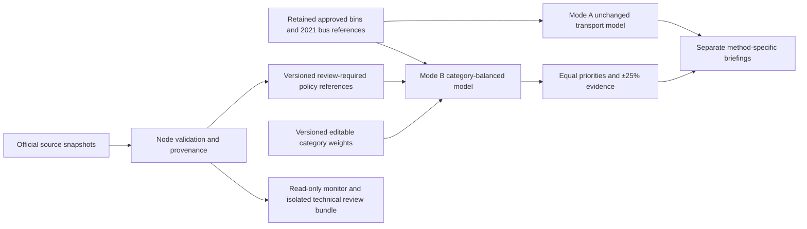

# Bin Policy v1.2 — audit and implementation plan

Delivery status checked 2026-10-16: [PR #15](https://github.com/LEO0331/taipei-bin-map/pull/15) is merged, merge commit `1280011b086f498404abf138c29f64041963e14c`, head `01d07aa`. This record retains the pre-merge implementation/test evidence; merging feature code does not change research inputs into approved operational data. Actual hosting deployment and hosted workflow outcomes were not verified in the documentation audit.

## Baseline and boundaries

- Clean `origin/main` `1a048dd` contains PR #11 (MVP) and #14 (governance). Dedicated feature branch: `codex/bin-policy-v1-2`.
- Startup: `npm ci` passed with zero reported vulnerabilities; 186 unit/component/data tests, TypeScript/build and 122 desktop/mobile E2E cases passed (two workers, port 5214).
- Existing policy data, reconciliation, health reports, frozen bus comparison and review-controlled workflows remain retained. The approved 2021 bus references remain the baseline; the newer StopLocation feed is not silently adopted.
- The [August 10 policy announcement](https://www.gov.taipei/News_Content.aspx?n=F0DDAF49B89E9413&s=798A998A29BE46CD) motivates analysis categories, not official coefficients. Proposed weights are user-approved scenario assumptions, not measured footfall or waste volume.
- The [historical procedure](https://laws.gov.taipei/Law/LawSearch/LawArticleContent/FL076512) is marked stopped/repealed from 2022-08-24. Neither its historical sidewalk-width rule nor its 50m spacing is enforced as current law. Minimum separation remains an optional analytical assumption; current rules and field conditions require separate verification.

## Architecture and implementation plan

1. **Source engineering:** inspect official tourism, vendor, market, commercial and MRT resources; freeze actual raw responses and provenance; reuse validated district geometry; retain excluded/context-only data. No geocoding or invented centroids. Acquisition failure means an unavailable category, not fabricated points.
2. **Pure weighted engine:** independent `policy-balanced-coverage-v1` with central `policy-priority-weights-v1` defaults 4/4/3/3/2/1 and finite nonnegative bounded editing. Freeze category denominators for each scenario, canonicalize verified entities, index neighbourhoods and use deterministic selection. Do not modify `greedy-equal-reference-coverage-v1`.
3. **Dashboard:** explicit A/B mode selector; lazily load B's research snapshot; review assumptions, apply scenario, inspect raw and weighted category gains, compare equal/default/sensitivity rankings, then export provenance-rich JSON/CSV. Preserve A's existing controls, evidence, exports and v1.1 disclosures.
4. **Governance:** source, method and weights are separate versions. New inputs remain review-required until explicitly adopted, with read-only source monitoring and isolated exact-hash review preparation. Never replace the approved baseline merely because ETL succeeded.
5. **Verification and delivery:** unit/ETL/browser regression, real citywide timing and mobile-profile interaction evidence, offline/tile failure, reproducible reports, bilingual documentation, staged commits and a feature PR for independent review only.



## Formula and unit

For candidate c, incremental gain is `Σ_k weight[k] × newlyCovered[k,c] / N[k]`, with N fixed to all valid, canonical eligible category entities in the selected area. N=0 omits that term and marks the category unavailable; weight is not redistributed. A weight of four is not four times garbage demand. A POI is not an accessible sidewalk or approved installation site. Default candidates use transport reference anchors, separate from the places whose coverage is evaluated.

## Completed implementation (2026-10-16)

The original `analysis.json` and `src/lib/binPolicyDecision.ts` remain byte-for-byte unchanged. Mode A, reconciliation, Data Health and bus comparison remain available. Mode B uses a separate lazy module and research snapshot `priority-v1-113edf6ed5e09ada`, bound to approved base `v1-14c24bcdbade` and the original bus SHA256. No newer StopLocation adoption, government workflow, prediction service or other repository change occurred.

| Category | Raw evidence | Valid reference entities | Decision |
| --- | --- | ---: | --- |
| Tourism | API/Swagger acquisition HTTP403 | unavailable | Retain blocked response evidence; adapter fixtures do not prove the live schema |
| Vendor concentrations | 47 published rows | 42 | Reviewed operating aliases, not all declared night markets |
| Traditional markets | 47 rows | 47 | Source points only, not sidewalk siting geometry |
| Commercial introduction / associations | 65 + 170 contextual rows | unavailable | Description/mailing address is not defensible district geometry |
| MRT | 124 GeoJSON features | 73 | Verified EPSG:3826 conversion; 48 outside/ambiguous and three reviewed interchange aliases excluded |
| Bus | Retained 3,407 source features | 3,395 | Approved historical baseline, not the newer comparison feed |

The result has 3,557 references and 3,468 distinct transport candidate anchors citywide. Original bytes, complete hashes, provider dates, raw fields, exclusions and source statuses are preserved. Scoped `.gitattributes` disables Git newline conversion for policy raw archives. Git-object checks exposed prior normalization of the retained bin and reconciliation CSVs as well as new research CSVs; their recorded original bytes were restored in Git without changing source values, dates, hashes or the approved analysis. All six new resource objects and the retained approved resources were checked against their manifest SHA256. This prevents Windows/Linux checkout normalization from corrupting reproducibility.

## Engine, explanations and safeguards

- Central defaults and bounds: `src/lib/policyPriorityWeights.ts`; source/reference contracts and audited source-category bindings: `policyPriorityTypes.ts`.
- Pure preparation/allocation/sensitivity: `policyBalancedCoverage.ts`. Grid lookup uses exact Haversine filtering, fixed denominators, explicit canonical identities and stable ID ties. Relative score tolerance preserves rankings under very small uniform weight scaling.
- Independent inspection found and closed two gaps with RED/GREEN tests: district ZIP provenance had to match the approved hash, and context-only/blocked references had to be rejected in runtime validation rather than relying on ETL/UI conventions. Source/category/availability and resource/date consistency now prevent such inputs being scored.
- Actual analysis-ready validation events are separate from raw archival checks and provider publication/retrieval dates. Unavailable publication metadata remains unknown.
- Candidate anchors are bus or bus+MRT source points; independent co-located references are not collapsed merely by proximity. The transport-only pool can leave non-transport gaps without a candidate; absence of a recommendation is not evidence of absent need.
- UI shows draft-versus-applied assumptions, applied weights, raw and weighted before/after coverage, per-category gains and all sensitivity omissions. No score/100, predicted demand, approved installation or unsupported robustness claim is produced.

## Example and sensitivity evidence

Same approved bins, citywide area, 300m radius, ten-anchor limit, zero minimum listed-bin separation and no cost/budget constraint:

| Configuration | Raw incremental entities | Weighted increment | Rank of bus-1210 |
| --- | ---: | ---: | ---: |
| Equal category priorities | 125 | 0.6747225 | 7 |
| Documented policy defaults | 125 | 2.1961240 | 3 |

Different weight scales are **not comparable policy effects**. The priority configuration changes ranking, not proof of reduced litter or collection cost. Its contributions are 13/42 vendor entities ×4, 12/47 markets ×3, 6/73 MRT references ×2 and 94/3,395 bus references ×1. Missing tourism/commercial terms are not redistributed.

Complete active/equal/default/±25% results, candidate contributions, omissions, source hashes and version dimensions are committed in [example JSON](../reports/bin-policy-v1.2/example-analysis.json) and [example CSV](../reports/bin-policy-v1.2/example-analysis.csv). There are 11 displayed sensitivity scenarios: equal, documented defaults, active weights and two variations for each of four available categories. Dataset composition and sparse samples remain interpretation limits.

## Governance and actual source checks

The existing weekly/manual workflow retains its v1.1 jobs and adds separate read-only research checks/artifacts and a deduplicated issue marker. No monitor commits data or changes approval status. `preparePolicyPriorityReview.ts` checks explicit exact hashes, base/method/weight versions and declared human technical review before writing a new nonproduction review bundle; it does not authorize publication or government installation.

Actual 2026-10-16 monitoring is retained in `reports/bin-policy/v1.2-monitor/`: five official resource downloads returned HTTP200 with unchanged bytes, while tourism returned HTTP403. The research monitor correctly reports **failure and exit code 1**, not success. Previous approved data remain intact. This byte monitor does not independently refresh official portal metadata; the limitation is explicit. GitHub-hosted scheduling, issue rights and human review were not exercised locally.

## Verification and performance evidence

- `npm ci`: passed; zero reported vulnerabilities, no dependencies added.
- `npm test`: **308 tests / 23 files passed**. Worker concurrency is bounded at four to avoid contention between jsdom and large GIS fixtures, without disabling test isolation or increasing test timeouts.
- `npm run build`: passed, including Node/application TypeScript. Mode B is a separate approximately 13.2KB-gzip lazy chunk; ordinary facility visits do not load its data.
- Full desktop/mobile Playwright: **142 passed**, two workers. Mode A golden behavior, B weights/reset/budget/sensitivity, source failure, provenance exports, language, mobile width and unavailable tiles are covered.
- Production-preview cache/offline flows: **four passed**, both modes on both device profiles.
- During development, a loading assertion and an original-mode CSV download event each timed out in separate full runs. The CSV case passed ten isolated repetitions; the final settled full run passed. Failure traces are now retained on the first failure; no retries or sleeps were added to mask them. These events are not claimed as eliminated environmental flakiness.
- Frozen references reproduce, including source identities/raw fields and coordinates to nine decimal degrees; actual validation-event timestamps may advance. Approved base/legacy engine remain unchanged. `git diff --check` passed.
- Actual citywide Node preparation/allocation/11-scenario sensitivity took about **0.71 seconds** on this Windows machine. See [timing/environment/input hash](../reports/bin-policy-v1.2/performance.json). Exact timing varies with load and is not a physical-phone claim.
- Desktop and mobile-profile browser interactions also passed a 4× CPU-throttled citywide ten-candidate flow under the 15-second engineering guard. Viewport/emulation is not measured handheld latency; per-run attachment evidence is generated by the E2E suite.
- New controls were visually compared against the established rounded civic controls. Scoped styling retains responsive layout and keyboard focus treatment rather than redesigning unrelated dashboards.

## Screenshots

Local E2E captures of the initial 中正區 research scenario, with external tiles blocked for deterministic tests. They are not a claimed public deployment preview.

[Desktop controls](images/bin-policy-v1.2-controls-desktop.png) · [Mobile controls](images/bin-policy-v1.2-controls-mobile.png)

## Reproduce

```bash
npm ci
npm run data:convert:policy-priority -- data/raw/bin-policy-priority/priority-v1-113edf6ed5e09ada data/raw/bin-policy/v1-14c24bcdbade/districts.zip
npm run data:example:policy-priority
npm run benchmark:policy-priority
npm test
npm run build
npm run test:e2e -- --workers=2
npm run test:policy-preview
git diff --check
```

For read-only live research checks (currently expected to fail for the blocked tourism source):

```bash
npm run data:monitor:policy-priority -- data/raw/bin-policy-priority/priority-v1-113edf6ed5e09ada public/data/bin-policy/priority-references.json test-results/priority-monitor
```

Use `PLAYWRIGHT_PORT` when 5173 is occupied. Regenerating references advances the recorded validation event; regenerate example/hash-bound monitoring artifacts after intentional data regeneration. The original approved snapshot is never the target of these commands. See the bilingual methodology and source/governance guides for exact semantics and technical-review preparation.

## Remaining limits and follow-up

Restore authorized tourism API access and verify the actual schema/pagination/classifications before admitting that category; mocked adapter tests are not live-source verification. Obtain defensible commercial public-space/boundary data rather than association offices. Review canonical identities, historical transport accuracy, sample completeness, walking access, maintenance and legal/site conditions. No output proves litter reduction, dumping prevention or cost savings. v1.3 operational sign-off/dispatch/sensors and portfolio work remain out of scope.
