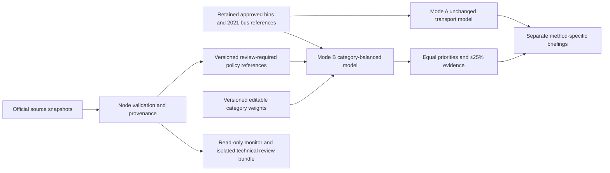

# Bin Policy v1.2 — audit and implementation plan

## Baseline and boundaries

- Clean `origin/main` `1a048dd` contains PR #11 (MVP) and #14 (governance). Dedicated feature branch: `codex/bin-policy-v1-2`.
- Startup: `npm ci` passed with zero reported vulnerabilities; 186 unit/component/data tests, TypeScript/build and 122 desktop/mobile E2E cases passed (two workers, port 5214).
- Existing policy data, reconciliation, health reports, frozen bus comparison and review-controlled workflows remain retained. The approved 2021 bus references remain the baseline; the newer StopLocation feed is not silently adopted.
- The [August 10 policy announcement](https://www.gov.taipei/News_Content.aspx?n=F0DDAF49B89E9413&s=798A998A29BE46CD) motivates analysis categories, not official coefficients. Proposed weights are user-approved scenario assumptions, not measured footfall or waste volume.
- The [historical procedure](https://laws.gov.taipei/Law/LawSearch/LawArticleContent/FL076512) is marked stopped/repealed from 2022-08-24. Neither its historical sidewalk-width rule nor its 50m spacing is enforced as current law. Minimum separation remains an optional analytical assumption; current rules and field conditions require separate verification.

## Architecture and implementation plan

1. **Source engineering:** inspect official tourism, vendor, market, commercial and MRT resources; freeze actual raw responses and provenance; reuse validated district geometry; retain excluded/context-only data. No geocoding or invented centroids. Acquisition failure means an unavailable category, not fabricated points.
2. **Pure weighted engine:** independent `policy-balanced-coverage-v1` with central `policy-priority-weights-v1` defaults 4/4/3/3/2/1 and finite nonnegative bounded editing. Freeze category denominators for each scenario, canonicalize verified entities, index neighbourhoods and use deterministic selection. Do not modify `greedy-equal-reference-coverage-v1`.
3. **Dashboard:** explicit A/B mode selector; lazily load B's research snapshot; review assumptions, apply scenario, inspect raw and weighted category gains, compare equal/default/sensitivity rankings, then export provenance-rich JSON/CSV. Preserve A's existing controls, evidence, exports and v1.1 disclosures.
4. **Governance:** source, method and weights are separate versions. New inputs remain review-required until explicitly adopted, with read-only source monitoring and isolated exact-hash review preparation. Never replace the approved baseline merely because ETL succeeded.
5. **Verification and delivery:** unit/ETL/browser regression, real citywide timing and mobile-profile interaction evidence, offline/tile failure, reproducible reports, bilingual documentation, staged commits and a feature PR for independent review only.

## Formula and unit

For candidate c, incremental gain is `Σ_k weight[k] × newlyCovered[k,c] / N[k]`, with N fixed to all valid, canonical eligible category entities in the selected area. N=0 omits that term and marks the category unavailable; weight is not redistributed. A weight of four is not four times garbage demand. A POI is not an accessible sidewalk or approved installation site. Default candidates use transport reference anchors, separate from the places whose coverage is evaluated.
