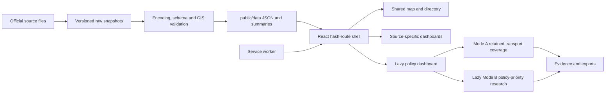

# System Design

[English](system-design.en.md) | [繁體中文](system-design.zh-Hant.md)

Reviewed against the repository on 2026-10-16. Counts describe retained snapshots, not live facility availability.

## Product and architecture

Static Vite + React + TypeScript, with a shared 22-type amenities map, eight dedicated discovery/directory/analytics routes, and `#/bin-policy`. No backend, authentication, database or paid map API. UI labels are bilingual; source addresses and district names remain Chinese. The optional English basemap preference was removed; maps use standard OpenStreetMap tiles.

Acquisition/conversion occurs before deployment. Runtime data requests are same-origin static JSON, not Taipei Open Data calls. Basemap tiles and external map links still involve third-party services.

## Data and rendering boundaries

- `src/types.ts` defines the shared `Facility` and source-specific contracts. Dedicated datasets are not forced into a bin-only schema.
- `scripts/convertBins.ts` composes shared data; dedicated converters decode UTF-8/Big5/CP950 and retain quality evidence. The retained `conversion-report.json` records 16,956 valid rows, generated 2026-07-21; this is not the policy inventory or a live count.
- `src/App.tsx` orchestrates routes, language, filters and location. Facility type starts empty, supports one selection, and allows deselection. Empty selection draws no facility markers or district summary bubbles.
- `src/utils/facilityUtils.ts` handles shared filtering, distance and labels. Browser geolocation requires permission, is not persisted by the app, and nearby lookup returns up to ten records.
- `FacilityMap.tsx` is lazy-loaded. Single-type results with at most 500 valid coordinates, or nearby results, show exact markers in batches. Ordinary lists mount the first 80 records; counts describe the full matching set.
- Address-only layers use explicitly labelled district summaries, not fabricated exact points. The contextual legend collapses; the result-limit notice sits below the adjacent facility-type panel.
- Dedicated modules have their own limits. Cooling currently draws individual points only after a filter/location is active, capped at 80. It does not compute grid clusters despite residual UI copy saying otherwise; correcting that copy/behavior remains an implementation follow-up.

See the [README route table](../README.md#data-modules) for module-specific boundaries.

## Policy analysis and governance

Mode A retains `public/data/bin-policy/analysis.json` and `src/lib/binPolicyDecision.ts`: 679 valid unique bin positions and 3,395 bus reference positions. Its internal A/B/C scenarios are distinct from the Mode A/B selector.

Mode B separately loads `priority-references.json`: 42 vendor concentrations, 47 markets, 73 MRT references and 3,395 bus references (3,557 entities). Tourism is blocked and commercial geometry unavailable. `policyBalancedCoverage.ts` with `policyPriorityWeights.ts` computes fixed-category-denominator weighted gain, not demand, walking access or siting approval. Source, method and weight versions remain separate in exports.

Read-only monitoring does not adopt inputs. Research review bundles and approved-data publication are separate. Scoped `.gitattributes` rules preserve raw archive bytes. See [v1.2 methodology](bin-policy-v1.2-methodology.md) and [governance](bin-policy-v1.2-governance.md).

## Caching and verification

`public/service-worker.js` uses network-first for navigation, `/assets/` and `/data/bin-policy/`; ordinary `/data/`, icons and manifest use cache-first. Policy datasets are cached after use, not precached with the ordinary map. Network failure can fall back to cached input; HTTP error responses are not silently replaced by stale data. External tiles are not cached by this worker. Registration is production-only.

Vitest covers utilities, converters, components, GIS and governance; Playwright covers desktop/mobile flows. After building, `npm run test:policy-preview` checks production service-worker/offline behavior. See [current handoff](../session-handoff.md) for dated verification, not claims of live deployment or cloud workflow success.
