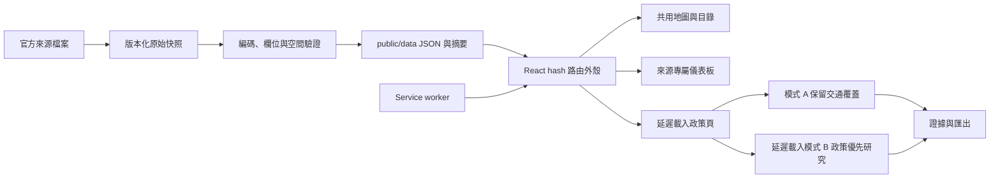

# 系統設計

[English](system-design.en.md) | [繁體中文](system-design.zh-Hant.md)

2026-10-20 依目前程式與保留快照核對。以下筆數不是即時營運數。

## 產品與架構

Vite + React + TypeScript 靜態網站，包含 22 種設施的共用地圖、八個獨立探索／目錄／統計路由，以及 `#/bin-policy`、`#/shade-equity`。沒有後端、登入、資料庫或付費地圖 API。介面雙語，來源地址與行政區保留中文；選配英文底圖已移除，各地圖使用標準 OpenStreetMap 圖磚。

資料擷取與轉換在部署前完成；前端只請求同站靜態 JSON，不呼叫臺北市開放資料 API。底圖與外部地圖連結仍使用第三方服務，不能把靜態資料誤解為整張地圖完全不需網路。

## 資料與渲染邊界

- `src/types.ts` 定義共用 `Facility` 及來源專屬型別，不再只有清潔箱、狗便袋箱與公廁三種類型。
- `scripts/convertBins.ts` 整合主設施資料；專屬腳本處理 UTF-8／Big5／CP950 與品質紀錄。保留的 `conversion-report.json` 於 2026-07-21 生成，含 16,956 筆有效紀錄，不是政策箱位母體或現況營運數。
- `src/App.tsx` 協調路由、語言、篩選與定位。設施類型預設不選，最多選一種，再次點擊可取消；未選時不繪製設施點與行政區摘要泡泡。
- `src/utils/facilityUtils.ts` 提供篩選、距離及標籤工具。定位須授權，專案不保存精確位置；附近查詢最多列出十筆。
- `FacilityMap.tsx` 延遲載入；單一類型且有效座標不超過 500 筆，或附近結果，才分批顯示精確標記。一般清單呈現前 80 筆，符合數仍依完整篩選集合計算。
- 地址型圖層使用明示的行政區摘要，不假造精確位置。圖例可展開／收合；大量結果提示位於相鄰設施類型面板下方。
- 獨立模組有自己的限制。涼適點目前須啟用篩選或定位才繪製個別點，最多 80 筆；程式未計算網格叢集，殘留的叢集提示與實際行為不符，應另案修正介面文案／行為。

各模組使用界線見 [README 路由表](../README.zh-Hant.md#資料模組)。

## 政策分析與治理

模式 A 保留 `analysis.json` 與 `src/lib/binPolicyDecision.ts`，使用 679 個有效去重箱位、3,395 個公車參考位置；內部 A/B/C 情境不可與模式 A／B 選擇混淆。

模式 B 另載入 `priority-references.json`：42 處攤販集中場、47 處市場、73 處捷運參考位置、3,395 處公車參考位置，共 3,557 個實體。觀光受阻、商圈幾何缺漏。`policyBalancedCoverage.ts` 搭配 `policyPriorityWeights.ts` 計算固定類別母體的加權新增覆蓋，不推論需求、步行可達或設置核准。匯出分別保留來源、方法與權重版本。

只讀監測不會自動採用新輸入；研究審查包與核准資料發布分開。原始封存檔透過限定範圍的 `.gitattributes` 保留位元組。詳見 [v1.2 方法](bin-policy-v1.2-methodology.zh-Hant.md)與[治理](bin-policy-v1.2-governance.md)。

## 快取與驗證

### 獨立樹蔭證據查核

2026-10-20 新增延遲載入的樹蔭研究路由，使用分離的型別、來源、投影 GIS、證據層級引擎與匯出。行道樹、人行道與樹穴不與園樹／受保護樹木混用；原檔以無損壓縮與 SHA256 保留。離線索引關聯產出小型盤點摘要與十二個按需載入的行政區檔，不在瀏覽器交叉比對全部樹木與多邊形；載入時檢查分區／快照身分。

實際長度定義與涵蓋可比較性門檻仍未通過，這次真實來源功能為盤點／關聯查核，不是已啟用的遮蔭或密度排名；不合成樹冠、熱暴露或空穴。詳見[方法](shade-equity-methodology.md)與[交付證據](shade-equity-delivery.md)。新資料載入器支援 Vite base，不代表其他模組既有的根目錄絕對路徑已改造，或整站已支援 GitHub Pages 子路徑。

樹蔭 JSON 使用後才以 network-first 快取，不加入一般地圖預載。production 離線驗證為 `npm run test:shade-preview`；原模式 A／B 另由政策 preview suite 驗證。

`public/service-worker.js` 對導覽、`/assets/` 與 `/data/bin-policy/` 使用 network-first，其他 `/data/`、圖示及 manifest 使用 cache-first。政策資料使用後才快取，不隨一般地圖預先下載；網路失敗可回復已快取輸入，但 HTTP 錯誤回應不會默默改成舊資料。外部圖磚不由此 worker 快取；只在 production 註冊。

Vitest 涵蓋工具、轉換、元件、GIS 與治理；Playwright 涵蓋桌機／手機流程。建置後可用 `npm run test:policy-preview` 驗證 production service-worker／離線行為。歷史驗證見[目前交接](../session-handoff.md)，不等於已驗證線上部署或 GitHub 工作流程。
